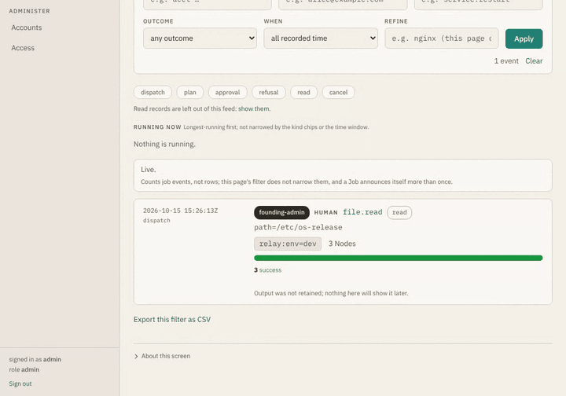
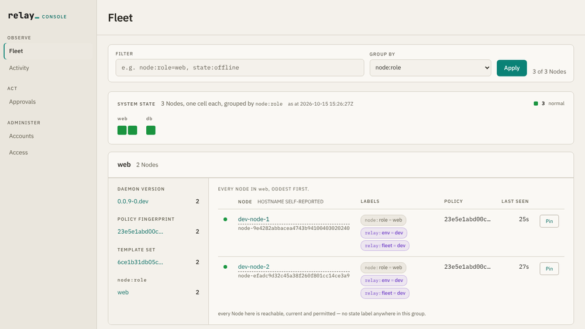

# Relay

<p align="center">
  <picture>
    <source media="(prefers-color-scheme: dark)" srcset="docs/brand/relay-wordmark-dark.svg">
    
  </picture>
</p>

**Relay lets you hand your fleet to an AI without handing it trust.**

Relay is a fleet-administration control plane for Linux servers. An AI-agent drives it as an
MCP tool. Each managed server still decides for itself what may run.

- **Node-rooted Policy.** Every Node holds its own root-owned Policy that nothing on the wire
  can widen. A compromised Relay still cannot exceed it.
- **Typed Operations.** The AI-agent calls structured Operations, not shell strings. Raw Exec is
  a regex-gated escape hatch for the long tail.
- **Blast cap and approval.** A hard cap limits how many Nodes one call can reach. Approval
  gates make chosen dispatches wait for a human.

## Quickstart

You need Docker Engine with the Compose v2.18+ plugin. The first run compiles both programs
inside Docker images, which takes a few minutes. After that, bringing the fleet up takes
seconds.

Start one Relay and three relay-daemons. The command returns once every daemon is healthy:

```console
$ make dev-fleet-up
…
 Container relay-demo-daemon-2-1 Healthy
 Container relay-demo-relay-1 Healthy
 Container relay-demo-daemon-3-1 Healthy
 Container relay-demo-daemon-1-1 Healthy
```

Export the fleet's CA certificate and control-plane credentials to `./.dev-fleet/`:

```console
$ make dev-fleet-creds
env -u STATE_DIR -u BASE bash scripts/dev-fleet-mcp.sh init
 relay-demo-relay-1 Copying relay-demo-relay-1:/var/lib/relay/ca/ca-cert.pem to .dev-fleet/ca-cert.pem
 relay-demo-relay-1 Copied relay-demo-relay-1:/var/lib/relay/ca/ca-cert.pem to .dev-fleet/ca-cert.pem
dev-fleet-mcp: CA cert and both credentials are in .dev-fleet/
dev-fleet-mcp: copy-paste launch commands: .dev-fleet/start-claude.txt
```

Call the MCP `run_operation` tool. This reads `/etc/os-release` on every dev Node:

```console
$ scripts/dev-fleet-mcp.sh call run_operation '{"selector":"relay:env=dev","operation":"file.read","args":{"path":"/etc/os-release"},"wait_seconds":30}'
…
    "structuredContent": {
      "job_id": "job-bc14009ea5e0173ea03ad28a675e8943",
      "job_status": "complete",
      "results": [
        {
          "duration_ms": 8,
          "exit_code": 0,
          "node_id": "node-9e4282abbacea4743b94100403020240",
          "outcome": "success",
          "stderr": "",
          "stderr_truncated": false,
          "stdout": "PRETTY_NAME=\"Relay dev-fleet (busybox)\"\nNAME=\"Relay dev-fleet\"\nID=relay-dev-fleet\n",
          "stdout_truncated": false
        },
…
```

Now ask for `/etc/shadow`. The fixture Policy on each Node denies it, so nothing executes:

```console
$ scripts/dev-fleet-mcp.sh call run_operation '{"selector":"relay:env=dev","operation":"file.read","args":{"path":"/etc/shadow"},"wait_seconds":30}'
…
    "structuredContent": {
      "job_id": "job-c700bdb3f855924418508ce6e486645e",
      "job_status": "complete",
      "results": [
        {
          "duration_ms": 7,
          "node_id": "node-9e4282abbacea4743b94100403020240",
          "outcome": "denied_by_policy",
          "refusal_explanation": "Refused by the Node, not by this control plane \u2014 a refusal, not a failure: nothing executed. Policy is local to the Node: the relay-daemon loads it from that Node's own disk, and the Relay has no code path to add, change or relax a rule over the wire (ADR-0002). The Node is never told which Account or role asked \u2014 the wire contract carries no caller identity \u2014 so the same request reaching the Node gets the same answer whoever asks, and no credential this control plane can issue changes it. Where the answer is a Policy rule, widening it is a deliberate human change on the Node itself, delivered by your own config management, and never something this control plane can do.",
          "stderr": "denied by explicit rule for operation 'file.read'",
          "stderr_truncated": false,
          "stdout": "",
          "stdout_truncated": false
        },
…
```

The verdict is the daemon's, not the Relay's. The Relay never evaluates Policy.

The same refusal in the Console, at `https://127.0.0.1:9443/console/` (sign in as `admin` /
`admin1234567`):

<p align="center">
  
</p>

<p align="center">
  
</p>

This fleet is dev-only: committed credentials, a fixture Policy, one host.
[docs/dev-fleet.md](docs/dev-fleet.md) covers Claude Code, the approval gate and the Console
in depth. A real deployment starts at
[docs/operations/relay-install.md](docs/operations/relay-install.md). `make dev-fleet-down`
stops the fleet.

## How it works

```
┌─────────────┐   MCP    ┌──────────────────┐  gRPC/mTLS   ┌────────────────────┐
│  AI-agent   │ ───────▶ │      Relay       │ ◀─ dial home ─│   relay-daemon ×N  │
│ (MCP client)│  tools   │  (Go server)     │  persistent   │   (Rust, per Node) │
└─────────────┘          └──────────────────┘   bidi stream └────────────────────┘
                                                                  │ enforce local Policy
                                                                  ▼ execute Operation / Raw Exec
```

Relay is two programs.

The **Relay** is a central server, written in Go. It holds the registry of Nodes, resolves
which ones a request targets, authorizes the caller, caps how far one action may reach,
dispatches the work and records what happened. It is also the private CA that issues each
Node's identity at enrollment. It is the only thing that talks to the fleet, and the only thing
an operator or an AI-agent talks to.

The **relay-daemon** is a small Rust daemon on every managed server. It dials out to the Relay
and holds one persistent connection, so no server needs an inbound port. It checks each Task
against a root-owned Policy file on its own disk and runs only what that Policy permits. It is
not an AI and does not reason. Node Policy beneath a Relay that already authorizes and caps is
defense in depth.

Three surfaces reach the Relay: the MCP surface an AI-agent drives, the Control API for
tooling, and the Admin Console for humans. All three are adapters over one capability layer,
so what may be done, by whom, and how it is recorded is decided once.

- **Typed Operations, not shell strings.** Structured Operations are the primary primitive;
  regex-gated **Raw Exec** covers the long tail. Between them, **Template Operations** are
  operator-authored: the command structure is fixed in a root-owned local file and every
  parameter reaches the shell as data, so an argument can never change which command runs.
  New vocabulary is Templates, never new Natives.
  ([ADR-0001](docs/adr/0001-structured-operations-with-regex-gated-raw-exec.md),
  [ADR-0021](docs/adr/0021-local-template-tier-shipped-read-catalog-native-freeze.md))
- **The Node distrusts the Relay.** Policy is locally-rooted and remotely-immutable, so a
  compromised Relay or jailbroken AI-agent still cannot exceed a Node's local limits.
  ([ADR-0002](docs/adr/0002-node-side-policy-is-locally-rooted-and-remotely-immutable.md))
- **Selector fan-out.** The AI-agent targets Nodes by label Selector; one call fans out across
  the fleet under a hard blast-radius cap.
  ([ADR-0003](docs/adr/0003-mcp-meta-tool-surface-with-selector-fan-out.md),
  [ADR-0004](docs/adr/0004-async-job-execution-model.md))
- **Outbound-only, mutually authenticated.** Daemons need no inbound ports; identity is an
  mTLS client cert issued at enrollment.
  ([ADR-0005](docs/adr/0005-grpc-bidi-over-mtls-transport.md),
  [ADR-0006](docs/adr/0006-node-enrollment-identity-and-label-authority.md))
- **Tags people control** (designed for the MVP). Operators group Nodes with `tag:` labels, set
  at enrollment or later in the Console. No AI-agent and no Node can write one.
  ([ADR-0050](docs/adr/0050-tags-are-the-operators-labels.md))

## MCP tools

The MCP surface registers eight tools. Each line is taken from the tool's own description.

| Tool | What it does |
|---|---|
| `list_nodes` | List Nodes in the fleet registry, optionally filtered by a Selector. |
| `describe_node` | Describe one Node in full, including its effective Policy as last reported by the daemon. |
| `list_operations` | List the Operation vocabulary: each Operation's purpose, risk class, argument names, types and constraints, and a usage example. |
| `run_operation` | The default way to act on Nodes: run a structured Operation against a Selector's matched Nodes. |
| `raw_exec` | The escape hatch, for when no structured Operation expresses the task: run an argv that each Node's Policy regex allows or refuses. |
| `get_job` | Re-read a Job's per-Node results by id. |
| `cancel_job` | Cancel a Job's Tasks. |
| `approve_request` | Answer a parked approval request: the in-band decision path, relaying a decision a human actually made. |

The Control API exposes the same capability layer to tooling; its reference is
[docs/api/](docs/api/).

## Who Relay defends against

The design must hold when each of these is true, individually or together:

- The AI-agent is jailbroken or hallucinating, and is issuing instructions in earnest.
- The Relay itself is fully compromised — an attacker holds the control plane.
- A Node is compromised and is lying to the Relay about what it is.
- The human operator is malicious or mistaken, and is using legitimate credentials.

Each has a structural answer beneath whatever procedural one it also has. That is what the
architecture invariants in [AGENTS.md](AGENTS.md) encode, and what
[docs/security/threat-model.md](docs/security/threat-model.md) maps boundary by boundary.

### Why it is built this way

Ansible, Salt and Chef were designed around a **trusted human operator**: the control plane
amplifies whatever the operator says, and safety is procedure layered on top. That holds only
while the operator is careful, honest and human. Relay assumes none of the three.

Relay does not try to avoid remote code execution; it *is* remote code execution, offered
deliberately. Its purpose is to make that capability **bounded, attributed, previewable and
survivable**, so that granting it is a rational decision rather than an act of faith.

The core move: **the enforcement that matters lives on the machine being protected, not in the
thing asking.** A control that lives only in the control plane evaporates the moment the
control plane is owned. A control rooted on the Node does not. So the design question is never
"how hard is this to break into" but **"what is still true after it has been broken into."**

Procedure is kept (approval, step-up re-authentication, an emergency Freeze), but never alone:
each procedural control has a structural floor beneath it that holds when the person fails.

A jailbroken AI-agent is the most demanding case of the general problem: untiring, fast,
plausible and wrong. A design that holds against it also holds against a human with stolen
credentials, because the architecture never asks who is asking.

## Status

Alpha: 0.1.0 is the first release. Relay is source-available under the
[Business Source License 1.1](LICENSE): free for personal, non-commercial use by individuals;
use by or for an organization needs a commercial license. Each version converts to Apache-2.0
three years after its release (its Change Date). Issues are welcome; code contributions from
outside Felag Engineering are not accepted (see [CONTRIBUTING.md](CONTRIBUTING.md)).

**GitHub milestones are the authority on what is in progress**, and GitHub releases on what has
shipped. [docs/STATUS.md](docs/STATUS.md) says what `main` does today, capability by
capability; [docs/proposals/](docs/proposals/) holds the reasoning behind decisions already made. [docs/how-relay-works.md](docs/how-relay-works.md)
is the whole system in plain words.

Gleipnir is a separate first-party AI-agent system that drives Relay as an ordinary consumer of
its MCP and Control API surfaces, with no special privileges. The repository was renamed from
`gleipnir-relay`; GitHub redirects the old URL.

## Security

Relay is remote code execution as a service, by design. Report a vulnerability privately, never
in a public issue: [SECURITY.md](SECURITY.md) has the channel and the supported versions.

## Documentation

- **[docs/dev-fleet.md](docs/dev-fleet.md)**: the local dev fleet in depth, drivable over MCP from Claude Code or any other MCP client.
- **[docs/operations/](docs/operations/)**: operator runbooks for installing, enrolling, upgrading, auditing and recovering a fleet.
- **[docs/specs/](docs/specs/)**: capability specifications, saying what each capability does today across MCP, the Control API, and the Admin Console.
- **[docs/adr/](docs/adr/)**: why the architecture is the way it is.
- **[GLOSSARY.md](GLOSSARY.md)**: the ubiquitous language. Every term here is canonical.
- **[AGENTS.md](AGENTS.md)**: how to work in this repo, the [repository layout](AGENTS.md#repository-layout), and the fourteen architecture invariants that constrain every change.
